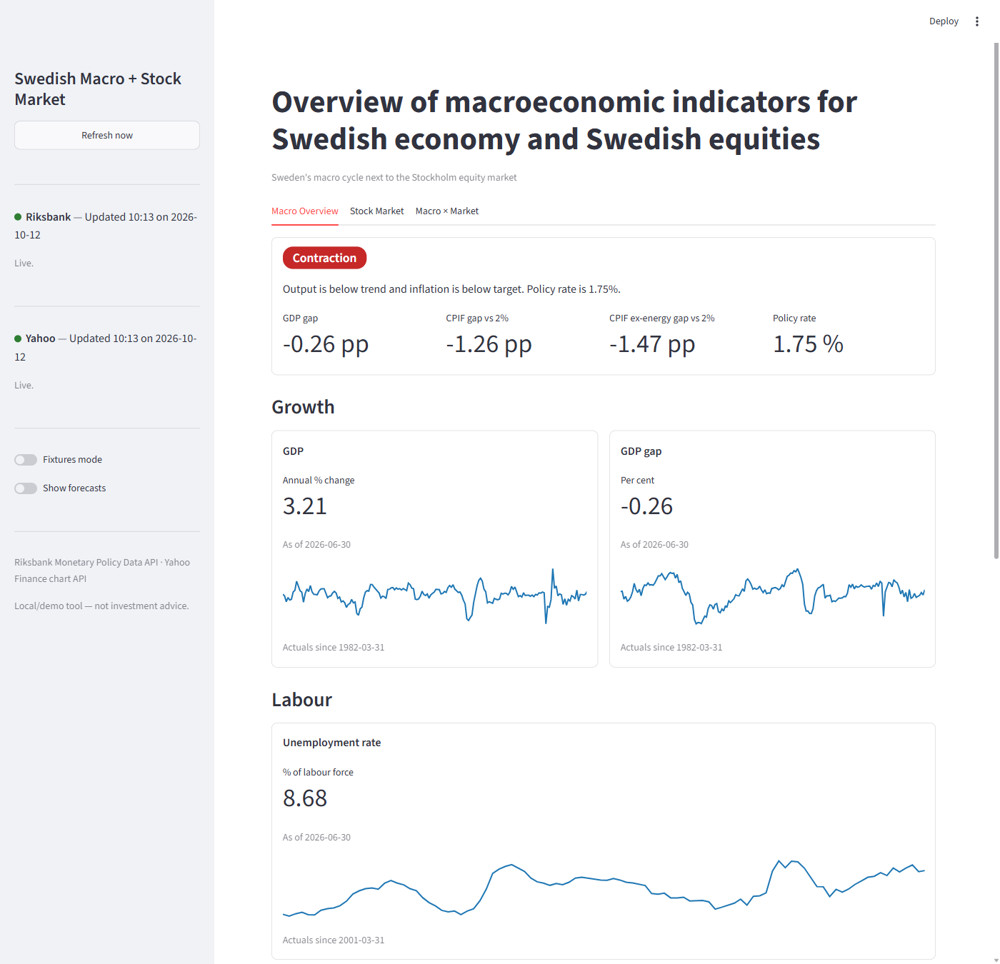
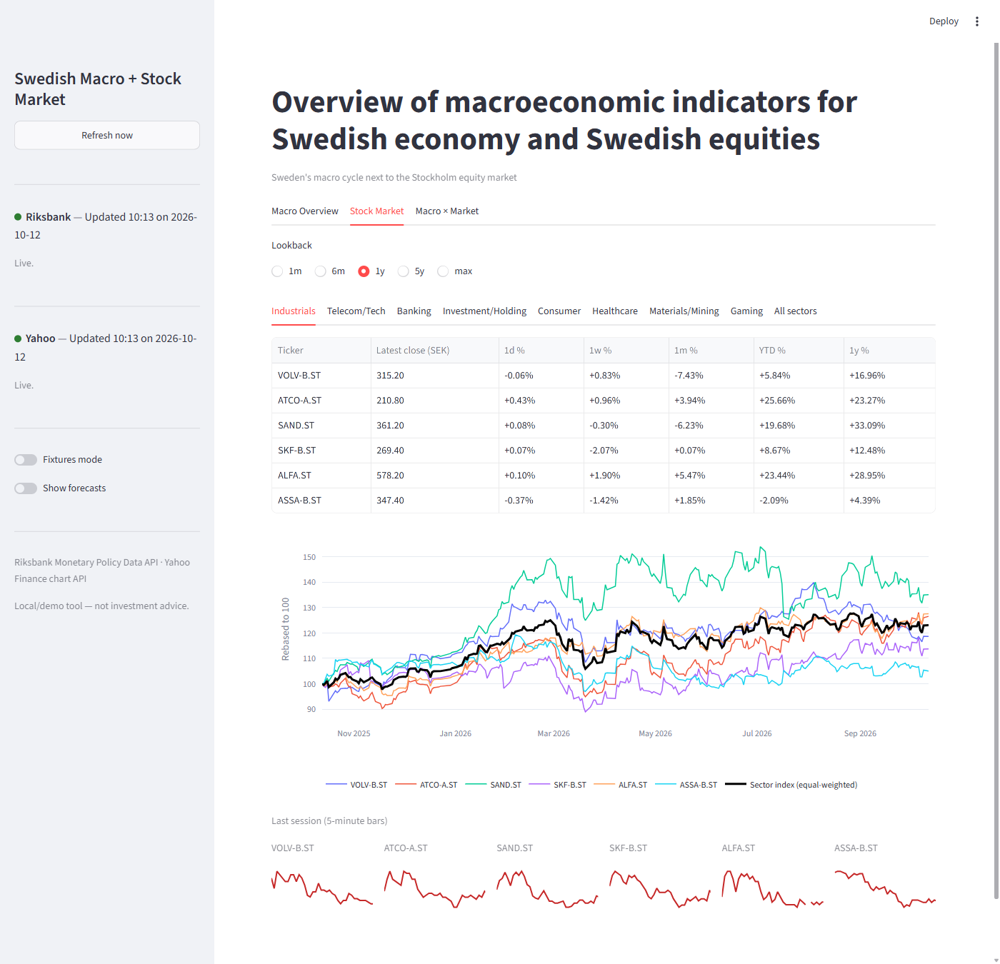
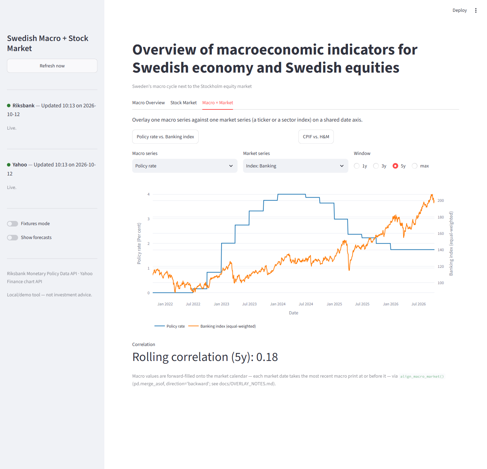

# Swedish Macroeconomic Indicators & Stock Market Dashboard

*Built through agent orchestration · Riksbank (Central Bank of Sweden) API + Yahoo Finance API*

A local Streamlit dashboard that puts Sweden's macro cycle (Riksbank Monetary Policy Data
API) next to the Stockholm equity market (Yahoo Finance chart API) in one place. It's both a
portfolio piece demonstrating a multi-source, schema-driven data app and a genuinely usable
tool for a Sweden-focused analyst who wants a single screen answering "where are we in the
cycle, and how is the market positioned against it?"

See `docs/SPEC.md`, `docs/UI_PLAN.md` and `docs/CHART_SPECS.md` for the full product/UX spec this app
implements.

## Tech stack

**Data**
- Riksbank Monetary Policy Data API (policy rate, inflation, macro series)
- Yahoo Finance chart API for Stockholm equities
- `requests` + `tenacity` for retries; schema-driven validation; local CSV snapshot fallback

**Processing**
- `pandas` transforms for macro, market and macro-vs-market overlays
- Frequency alignment of monthly/quarterly data with daily prices

**App**
- Streamlit with three tabs (Macro Overview, Stock Market, Macro × Market)
- Interactive Plotly charts, sidebar refresh, per-source staleness badges

**Tooling**
- `uv` for dependency management, `pytest` (unit + app smoke tests), `ruff`

## How it was built: a team of Claude Code subagents

The app was built by seven specialised [Claude Code subagents](https://code.claude.com/docs/en/sub-agents),
defined in [`.claude/agents/`](.claude/agents/). Each one owns specific files, so no two agents
edit the same module, and [`CLAUDE.md`](CLAUDE.md) is the shared ground truth they all read.

| Subagent | Model | Role | Output |
|---|---|---|---|
| `pm-plan` | Opus | Product manager: turns the idea into a spec and a task list | `docs/SPEC.md`, `docs/tasks.json` |
| `riksbank-data-expert` | Sonnet | Data engineer for the Riksbank API; owns the shared schema | `riksbank_client.py`, `macro_transforms.py`, `docs/RIKSBANK_NOTES.md` |
| `yahoo-data-expert` | Sonnet | Data engineer for the Yahoo Finance chart API | `yahoo_client.py`, `market_transforms.py` |
| `viz-ux-designer` | Sonnet | UX and chart design (no code) | `docs/UI_PLAN.md`, `docs/CHART_SPECS.md` |
| `macro-market-expert` | Sonnet | Aligns monthly/quarterly macro data with daily market data | `overlay_transforms.py`, `docs/OVERLAY_NOTES.md` |
| `streamlit-builder` | Sonnet | Builds the app from the specs and transform modules | `app.py`, `tabs/*`, this README |
| `verifier` | Haiku | Read-only QA gate: imports, tests and a headless app boot | Reports failures back to the owning agent |

Work ran in phases: planning → a shared-schema change → the two data agents and the designer in
parallel → the overlay logic → the app → verification after every step. The agents that write
code look up current library documentation through the
[context7 MCP server](https://github.com/upstash/context7) instead of relying on memory.

## Prerequisites

- [`uv`](https://docs.astral.sh/uv/) installed.
- Python >= 3.14 (uv will install/manage the interpreter for you if needed).

## Setup

```bash
uv sync
```

**Corporate/self-signed root CA environments:** if `uv sync` fails with a TLS/certificate
verification error (common behind a corporate proxy or a locally-trusted root CA), retry with:

```bash
uv sync --system-certs
```

This tells `uv` to trust your OS certificate store instead of only its bundled CA bundle.

## Run the app

```bash
uv run streamlit run app.py
```

This boots a three-tab dashboard with a sidebar refresh button and per-source staleness
badges. On first run, live data is fetched from the Riksbank and Yahoo Finance APIs (no API
keys required for either); if a live fetch fails, the app falls back to the last on-disk
snapshot and marks the affected source's badge amber.

To explore the UI with **no network access at all**, turn on the **Fixtures mode** toggle in
the sidebar — this swaps both data sources for deterministic, seeded sample data
(`data/fixtures.py`).

## Run the tests

```bash
uv run pytest
```

All HTTP calls are mocked in the test suite (or bypassed entirely via fixture data) — no live
network access is required or used.

## Lint

```bash
uv run ruff check .
```

## The three tabs

- **Macro Overview** — a "state of the cycle" summary tile (a composite label — Expansion /
  Recovery / Slowdown / Contraction / Neutral — with a one-line rationale and four supporting
  metric chips: GDP gap, CPIF gap vs. the 2% target, CPIF excl. energy gap, and the latest
  policy rate), followed by 7 tiles grouped under Growth / Labour / Prices / Policy. Each tile
  shows the latest actual value, its observation date, the real span of history available, and
  a sparkline; a sidebar "Show forecasts" toggle overlays a dashed forecast segment without
  changing the displayed latest-value number.

  

- **Stock Market** — a shared lookback selector (1m / 6m / 1y / 5y / max) above 9 sub-tabs: one
  per sector (Industrials, Telecom/Tech, Banking, Investment/Holding, Consumer, Healthcare,
  Materials/Mining, Gaming) plus "All sectors". Each sector sub-tab shows a performance table
  (latest close, 1d/1w/1m/YTD/1y % returns), a rebased-to-100 chart with every ticker plus a
  bold equal-weighted sector index line, and a "last session" strip of 5-minute intraday
  sparklines. "All sectors" shows one row per sector and a chart of all 8 sector indices.

  

- **Macro × Market** — pick any of the 7 macro series and any of the 19 tickers or 8 sector
  indices (or use one of the two "suggested pairs" quick-select buttons) to see a dual-axis
  overlay chart plus a rolling correlation readout for the selected window (1y / 3y / 5y /
  max). A caption states the exact alignment method used (forward-filling the macro series onto
  the market's trading calendar), per `docs/OVERLAY_NOTES.md`.

  

## Sidebar controls

- **Refresh now** — clears the app's cached fetches and re-runs both API calls immediately,
  bypassing the normal TTL (6 hours for Riksbank data, 15 minutes for Yahoo Finance data).
  Disabled while Fixtures mode is on.
- **Riksbank / Yahoo freshness badges** — always visible, independent of the active tab.
  🟢 green = live data, 🟠 amber = showing a stale on-disk snapshot after a failed live fetch,
  🔴 red = unavailable (fetch failed and no snapshot exists), ⚪ grey = Fixtures mode.
- **Fixtures mode** — swaps both sources for sample data; no network calls occur while it's on,
  even if Refresh now is clicked.
- **Show forecasts** — Macro Overview sparklines only; a reading preference, not a data toggle.

## Caching

There is no standalone cache module. Two layers, per `docs/SPEC.md` F5:

1. `st.cache_data(ttl=...)` wraps `riksbank_client.fetch_macro_series()` (6h TTL) and
   `yahoo_client.fetch_market_data()` (15min TTL) in `app.py`. Refresh now calls `.clear()` on
   both cached functions and reruns, forcing a fresh live fetch.
2. On-disk snapshot fallback lives inside each client itself (`riksbank_client.py`,
   `yahoo_client.py`) — a client returns its last successful snapshot with `is_stale=True` when
   a live fetch fails, rather than raising.

## Non-goals (MVP)

- No cloud deployment — local `uv run streamlit run app.py` only.
- No background scheduler/daemon; data refreshes only on rerun, Refresh now, or TTL expiry.
- No authentication, user accounts, or per-user settings.
- No series/tickers beyond the 7 Riksbank series and 19 Yahoo tickers in `constants.py`.
- No data editing, upload, or CSV export.
- No real-time/sub-hourly app refresh cadence (5-minute intraday bars are shown for the current
  session only, not streamed).
- No `yfinance` package usage (SSL verification fails against a locally-trusted root CA on the
  reference dev machine — the Yahoo chart endpoint is called directly via `requests` instead).
- No multi-vintage Riksbank forecast-revision comparison; one policy-round vintage per fetch.
- No company-name/market-cap/fundamentals lookup; a ticker's `metric_id` is its display name.
- No portfolio tracking, alerts, or trade signals — correlation is descriptive, not predictive.
- No mobile-specific layout; desktop browser at 1280px+ is the target.
